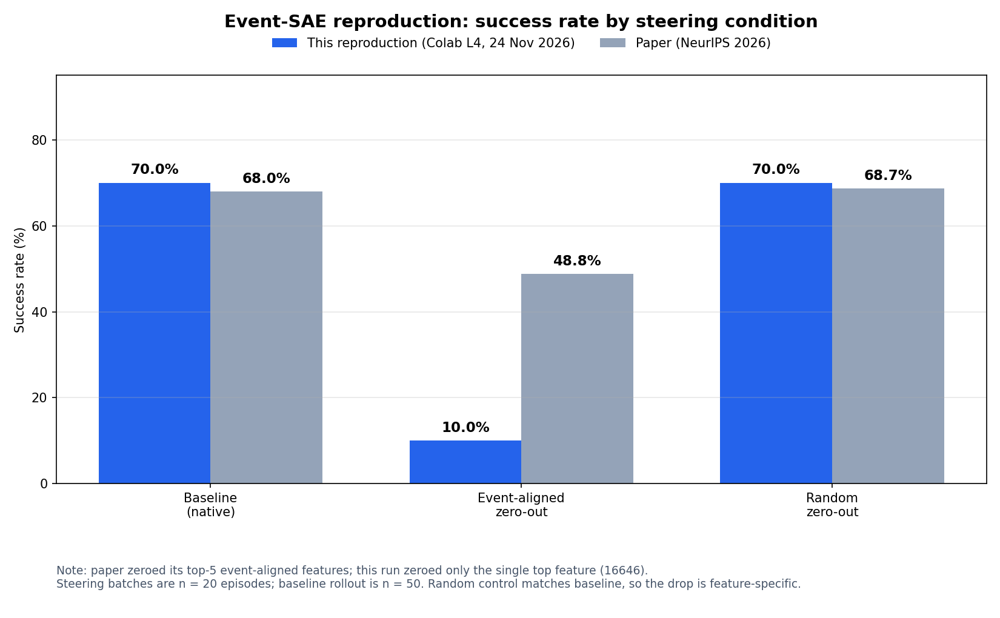

# Event-SAE Reproduction — OpenVLA 7B + LIBERO-Goal

Reproduction of the NeurIPS 2026 paper **"Event-Grounded Sparse Autoencoders for
Vision-Language-Action Policies"** (OpenVLA 7B + LIBERO-Goal), run on free Google
Colab with an L4 GPU on 24 November 2026.

- Paper code: https://github.com/xc-j/Event-SAE
- Notebook: [`Event-SAE-Colab-Setup.ipynb`](Event-SAE-Colab-Setup.ipynb) (56 cells)
- Full results bundle (36 GB zip): [Google Drive](https://drive.google.com/file/d/1ns6zEnEHnOTeERHA1H0dNDbtaSaKHuRY/view?usp=drivesdk)
  — the zip is **not** in this repo; GitHub cannot host a 36 GB file.

## Result in one line

Baseline reproduced at **70.0%** (paper: 68.0%). Zeroing a single event-aligned
feature (feature **16646**) dropped success to **2/20 = 10.0%**, while zeroing a
random feature left it at **70.0%** — the effect is feature-specific, and
stronger than the paper's top-5 ablation (48.8%). See the caveat in
[Results](#results): the paper zeroed its **top-5** features; this run zeroed
only the **single** top feature, so the two numbers are not a like-for-like
comparison.

## Paper summary

Vision-language-action (VLA) policies such as OpenVLA map language instructions
and camera images to robot actions, but their internal representations are hard
to interpret. The paper trains a sparse autoencoder (SAE) on the policy's
residual-stream activations, grounds the SAE's features in task *events*
(key moments in a rollout, e.g. grasping an object), and then *steers* the
policy by zeroing out event-aligned features to test whether those features are
causally important for success.

The paper's headline claim (OpenVLA, LIBERO-Goal, 100 episodes):

| Condition | Paper |
|---|---|
| Baseline (native) | 68.0% |
| Zero out top-5 event-aligned features | 48.8% |
| Zero out random features (control) | 68.7% |

## Method

### 1. Sparse autoencoder — equations

The equations below are the **standard sparse-autoencoder formulation** used by
this family of methods, written out to make the reproduction self-contained.
They are *not* claimed to be verbatim equations from the paper.

Let $x \in \mathbb{R}^{d}$ be a residual-stream activation of the policy
(here: layer 31, `resid_post`, of OpenVLA 7B). The SAE encodes it into a sparse
code $z \in \mathbb{R}^{d_{\mathrm{SAE}}}$ and reconstructs it:

**Encoding** (with a TopK sparsity constraint, $k = 64$ in this run):

$$\mathbf{z} = \mathrm{TopK}_k\left(\mathrm{ReLU}\left(\mathbf{W}_{\mathrm{enc}}\,(\mathbf{x} - \mathbf{b}_{\mathrm{pre}}) + \mathbf{b}_{\mathrm{enc}}\right)\right)$$

**Reconstruction:**

$$\hat{\mathbf{x}} = \mathbf{W}_{\mathrm{dec}}\,\mathbf{z} + \mathbf{b}_{\mathrm{dec}}$$

**Training objective** (reconstruction + sparsity penalty; $\lambda$ weights the
sparsity term):

$$\mathcal{L} = \|\mathbf{x} - \hat{\mathbf{x}}\|_2^2 + \lambda\,\|\mathbf{z}\|_1$$

Only the $k$ largest activations survive in $\mathbf{z}$; every other feature is
exactly zero. Each surviving feature is (in the paper's hypothesis) one
interpretable "concept" — here, one event in the robot's task.

### 2. Top-k feature extraction

Dense activations from the baseline rollout (`outputs/rollout/sae_activations/resid_post`,
layer 31) are passed through the **pretrained** SAE checkpoint
(`mr-cabbage/event-sae-libero`, `openvla/libero_goal/ae.pt`, 1.07 GB). No SAE
training is done in this reproduction. For every activation, the top $k = 64$
features are kept:

$$\mathrm{TopK}_{64}(\mathbf{z}) = \{(j, z_j) : z_j \text{ is among the 64 largest entries of } \mathbf{z}\}$$

Result: **2,426,654 rows** of top-k activations. (The original extraction cell
hit CUDA out-of-memory; it was re-run in 8,192-row chunks.)

### 3. Events: keyframes and clustering

- **Keyframes:** 187 keyframes extracted from the rollout trajectories
  (0 skipped).
- **Event features:** 187 events across 10 tasks, embedded with SigLIP and
  grouped into **42 event clusters**.

### 4. Event-aligned feature scoring — equation (schematic)

Each SAE feature $j$ is scored by how strongly it activates at event keyframes
versus elsewhere. Schematically, for feature $j$ and the set of event
keyframes $E$:

$$\mathrm{score}(j) = \frac{1}{|E|}\sum_{e \in E} \bar{z}_j(e)$$

where $\bar{z}_j(e)$ is the mean top-k activation of feature $j$ at keyframe
$e$. Features are ranked by this score; the ranking step in this run produced
20 candidates and a 42-row score table (dictionary size 32,768, as recorded in
`scores.pt`).

**Rank-1 event-aligned feature: 16646.**

### 5. Steering by zeroing a feature

Steering intervenes at layer 31 (`resid_post`) from step 0, with
`feature_alpha = 0.0` — i.e. the feature is switched off completely:

$$z'_{16646} = 0, \qquad z'_j = z_j \;\; (j \neq 16646)$$

Equivalently, with a mask $\mathbf{m}$ where $m_{16646} = 0$ and $m_j = 1$ otherwise:

$$\hat{\mathbf{x}}_{\mathrm{steered}} = \mathbf{W}_{\mathrm{dec}}\,(\mathbf{z} \odot \mathbf{m}) + \mathbf{b}_{\mathrm{dec}}$$

Three configs were written (`configs/steering/`):

| Config | Intervention |
|---|---|
| `colab_native.yaml` | None (baseline) |
| `colab_event.yaml` | Zero rank-1 event-aligned feature (16646) |
| `colab_random.yaml` | Zero a random alive feature (control) |

Success rate is the fraction of episodes completed:

$$\mathrm{Success\ rate} = \frac{\#\ \text{successful episodes}}{\#\ \text{total episodes}}$$

## Setup

- **Hardware:** Google Colab (free), NVIDIA **L4** GPU, 23,034 MiB; driver
  580.82.07, CUDA 13.0, torch 2.14.1+cu130, Python 3.13.16.
  The 7B model needs ~14 GB in bf16, so a T4 (16 GB) is too tight — L4 only,
  no 8-bit fallback in this notebook.
- **Policy:** OpenVLA 7B fine-tuned on LIBERO-Goal
  (`openvla/openvla-7b-finetuned-libero-goal`,
  revision `fa5ae1e7509348889295bba8e08621d8b55e9baf`), ~14 GB.
- **SAE:** pretrained checkpoint `mr-cabbage/event-sae-libero`
  (`openvla/libero_goal/ae.pt`), layer 31.
- **Benchmark:** LIBERO-Goal (checkout `f78abd6`), tasks 0–9.
- **Fixes applied in the notebook:** LIBERO `torch.load(..., weights_only=False)`
  patch; MuJoCo rendering switched to EGL (`MUJOCO_GL="egl"`, render test
  `RENDER OK (64, 64, 3)`); chunked top-k extraction (8,192-row chunks) to avoid
  CUDA out-of-memory.
- **Seed:** 0 for the steering batches.

## Pipeline (as run, 24 Nov 2026)

| Step | Notebook cells | Result |
|---|---|---|
| 1. Baseline rollout — 50 episodes, tasks 0–9, initial states 0–4 | 21 | **35/50 = 70.0%**, 06:34–08:48 PKT, 8,020.341 s |
| 2. Extract top-k features (k = 64, layer 31) | 51–55 (chunked) | **2,426,654 rows**, 253.674 s |
| 3. Keyframes | 25 | **187 keyframes**, 0 skipped, 1,193.791 s |
| 4. Event features + clustering | 26 | **187 events, 10 tasks, 42 clusters**, 31.908 s |
| 5. Scoring + rankings | 28 | Rank-1 feature **16646**, 20 candidates, 71.825 s |
| 6. Steering configs | 30 | `colab_native.yaml`, `colab_event.yaml`, `colab_random.yaml` |
| 7. Baseline batch — 20 episodes | 32 | **14/20 = 70.0%**, 3,088.556 s |
| 8. Event-aligned batch — zero feature 16646 | 33 | **2/20 = 10.0%**, 2,363.942 s |
| 9. Random batch — zero random alive feature | 34 | **14/20 = 70.0%**, 3,402.047 s |
| 10. Results table | 36 | See below, 13:33 PKT |
| 11. Zip all outputs | 39 | **36 GB**, 998.734 s, finished 19:11 PKT |
| 12. Save zip to Google Drive | 57 | **SIZE MATCH**, 19:51–19:54 PKT, 37,693,297,786 bytes |

## Results

| Condition | This run | Paper | Episodes |
|---|---:|---:|---:|
| Baseline (native) | **70.0%** (35/50 rollout; 14/20 batch) | 68.0% | 50 / 20 |
| Event-aligned zero-out | **10.0%** (2/20) | 48.8% | 20 |
| Random zero-out (control) | **70.0%** (14/20) | 68.7% | 20 |

### What the numbers mean

- **Baseline reproduced.** 70% on 50 episodes — and 70% again on the
  20-episode batch — is close to the paper's 68%. The setup works.
- **Feature 16646 matters a lot.** Zeroing it alone dropped success from 70%
  to 10% (last episode: "put the wine bottle on the rack", 300 steps, fail).
- **The control rules out a generic steering effect.** Zeroing a random feature
  left success at 70%, exactly the baseline — so the drop is specific to
  feature 16646, not to steering in general.
- **Do not quote "10% vs 48.8%" as a like-for-like comparison.** The paper
  zeroed its **top-5** event-aligned features; this run zeroed only the
  **single** top feature (16646). A single-feature ablation that drops success
  to 10% is a stronger effect than the paper's top-5 ablation, but it is a
  different intervention.

## Limitations

- **Small steering samples.** Both steering batches are n = 20, so 2/20 is a
  strong signal but not a precise estimate — read 10% as "about one in ten
  succeeded".
- **Single-feature vs top-5.** The paper's 48.8% comes from zeroing five
  features; this run zeroed one. The exact top-5 comparison was not run.
- **Baseline size.** The paper's numbers are for 100 episodes; this baseline
  is 50 episodes (rollout) plus a 20-episode batch.
- **One seed, one suite.** All steering batches used seed 0, and only
  LIBERO-Goal was tested — no other LIBERO suite and no other policy.
- **One feature analysed in depth.** Ranks 2–5 of the event-aligned ranking
  were computed (20 candidates) but not individually ablated.

## Future work

1. **Exact top-5 ablation** — zero the top-5 event-aligned features together,
   matching the paper's intervention, and compare directly with 48.8%.
2. **Full 100-episode runs** — baseline, event-aligned and random batches with
   `--initial-states 0-9`, as the notebook's optional step describes
   (~8–15 GPU-hours for all three on L4; split across sessions).
3. **Ablate ranks 2–5 individually** to see whether feature 16646 is unique or
   one of several critical features.
4. **More seeds** — repeat the steering batches with different seeds to check
   the 10% figure is stable.
5. **Other LIBERO suites / policies** — test whether event-aligned features
   generalise beyond LIBERO-Goal and OpenVLA-7B.
6. **Interpret feature 16646** — inspect the keyframes and events where it
   fires most strongly to say *what* it represents, not just that it matters.

## How to reproduce

1. Open [`Event-SAE-Colab-Setup.ipynb`](Event-SAE-Colab-Setup.ipynb) in Google
   Colab and pick the **L4** GPU (Runtime → Change runtime type → L4).
2. Run the cells top to bottom. Do not skip the patch cells (Step 3b) or the
   render test.
3. The run takes several hours: the baseline rollout alone is ~2h 13m, and each
   20-episode steering batch is ~40–57 minutes.
4. Cell 39 zips all of `outputs/` into `event-sae-results.zip` (36 GB here);
   Cell 57 copies it to Google Drive.

## Full results bundle

`event-sae-results.zip` (36 GB, 37,693,297,786 bytes) contains all rollouts,
dense activations, top-k features, keyframes, events, scores, rankings and the
three steering batches. Download it from
[Google Drive](https://drive.google.com/file/d/1ns6zEnEHnOTeERHA1H0dNDbtaSaKHuRY/view?usp=drivesdk).
It is not stored in this repo.

## Author

Hafiz Muhammad Ishaq — Deep Learning & Computer Vision.
Run completed 24 November 2026.
