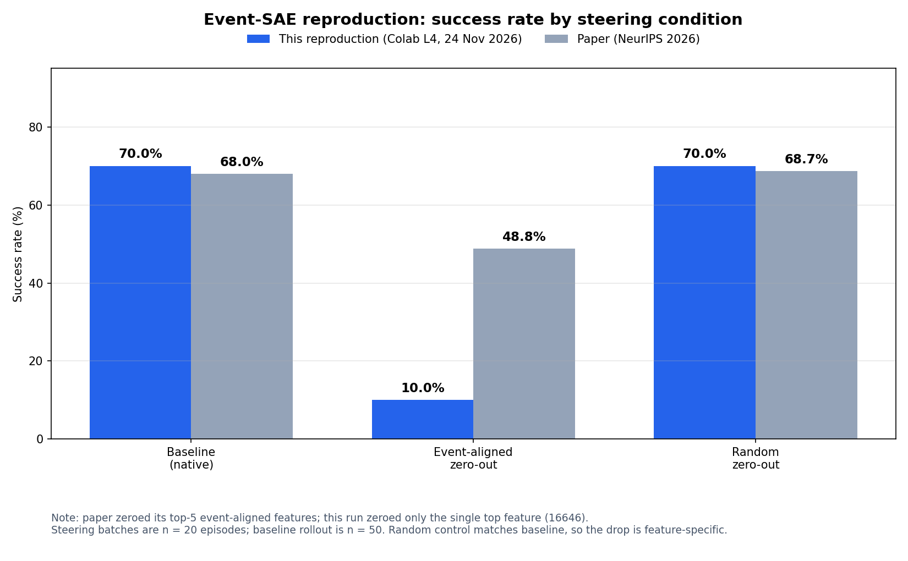

# Event-SAE reproduction — full results

Reproduction of NeurIPS 2026, "Event-Grounded Sparse Autoencoders for
Vision-Language-Action Policies" (OpenVLA 7B + LIBERO-Goal), run on free Google
Colab, L4 GPU, 24 November 2026. Notebook: `Event-SAE-Colab-Setup.ipynb`
(56 cells, Drive file ID `1ZXUnLytb7qKneTjtI5fGct8PIUA6iF7m`).

## Headline table

| Condition | This run | Paper | Episodes |
|---|---:|---:|---:|
| Baseline (native) | **70.0%** | 68.0% | 50 (rollout) / 20 (batch) |
| Event-aligned zero-out | **10.0%** | 48.8% | 20 |
| Random zero-out (control) | **70.0%** | 68.7% | 20 |

**Caveat:** the paper zeroed its **top-5** event-aligned features; this run
zeroed only the **single** top feature (16646). The 10% vs 48.8% comparison is
therefore not like-for-like — the single-feature effect is stronger than the
paper's top-5 effect, but it is a different intervention.

## Pipeline numbers

| Step | Result | Time |
|---|---|---|
| Cell 21 — baseline rollout, 50 episodes (tasks 0–9, initial states 0–4) | 35/50 = 70.0% | 06:34–08:48 PKT, 8,020.341 s |
| extract_topk (chunked, k = 64, layer 31) | 2,426,654 rows | 253.674 s |
| Keyframes | 187 keyframes, 0 skipped | 1,193.791 s |
| Event features + clustering | 187 events, 10 tasks, 42 clusters | 31.908 s |
| Scoring + rankings | rank-1 feature **16646**, 20 candidates, scores.pt 42 rows (dict 32,768) | 71.825 s |
| Cell 32 — baseline batch, 20 episodes | 14/20 = 70.0% | 3,088.556 s |
| Cell 33 — event-aligned batch, zero feature 16646 | 2/20 = 10.0% | 2,363.942 s |
| Cell 34 — random batch, zero random alive feature | 14/20 = 70.0% | 3,402.047 s |
| Cell 36 — results table | Baseline 70.0%, Event-aligned 10.0%, Random 70.0% | 13:33 PKT, 0.017 s |
| Cell 39 — zip of outputs | `event-sae-results.zip`, 36 GB | 998.734 s, finished 19:11 PKT |
| Cell 57 — save zip to Google Drive | SIZE MATCH, 37,693,297,786 bytes | 19:51–19:54 PKT |

## Equations used

Standard sparse-autoencoder formulation (not verbatim paper equations):

- Encoding: $\mathbf{z} = \mathrm{TopK}_{64}(\mathrm{ReLU}(\mathbf{W}_{\mathrm{enc}}(\mathbf{x} - \mathbf{b}_{\mathrm{pre}}) + \mathbf{b}_{\mathrm{enc}}))$
- Reconstruction: $\hat{\mathbf{x}} = \mathbf{W}_{\mathrm{dec}}\,\mathbf{z} + \mathbf{b}_{\mathrm{dec}}$
- Loss: $\mathcal{L} = \|\mathbf{x} - \hat{\mathbf{x}}\|_2^2 + \lambda\,\|\mathbf{z}\|_1$
- Steering (this run): $z'_{16646} = 0$, all other $z'_j = z_j$; i.e. $\hat{\mathbf{x}}_{\mathrm{steered}} = \mathbf{W}_{\mathrm{dec}}\,(\mathbf{z} \odot \mathbf{m}) + \mathbf{b}_{\mathrm{dec}}$ with $m_{16646} = 0$
- Success rate: $\mathrm{SR} = \frac{\#\ \text{successful episodes}}{\#\ \text{total episodes}}$

## Interpretation

- Baseline reproduced (70% vs paper 68%).
- Zeroing feature 16646 alone: 70% → 10%. Last episode of that batch:
  "put the wine bottle on the rack", 300 steps, fail.
- Random-feature control: 70%, identical to baseline — the drop is
  feature-specific, not a generic steering artefact.
- Steering batches are n = 20, so treat 10% as "about one in ten succeeded",
  not an exact rate.

## Limitations and future work

- Single-feature vs the paper's top-5 ablation — the exact top-5 run is the
  first follow-up.
- Baseline is 50 episodes; the paper reports 100.
- One seed (0), one suite (LIBERO-Goal), one policy (OpenVLA-7B).
- Ranks 2–5 computed but not individually ablated; feature 16646 not yet
  interpreted in terms of which events it fires on.

## Artefacts

- Full 36 GB bundle: [Google Drive](https://drive.google.com/file/d/1ns6zEnEHnOTeERHA1H0dNDbtaSaKHuRY/view?usp=drivesdk)
  (`event-sae-results.zip`, 37,693,297,786 bytes, SIZE MATCH verified).
- Setup: Colab L4 (23,034 MiB), torch 2.14.1+cu130, CUDA 13.0, Python 3.13.16;
  OpenVLA `openvla/openvla-7b-finetuned-libero-goal` rev.
  `fa5ae1e7509348889295bba8e08621d8b55e9baf`; SAE checkpoint
  `mr-cabbage/event-sae-libero` (`openvla/libero_goal/ae.pt`).
